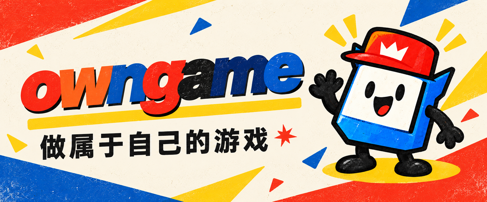
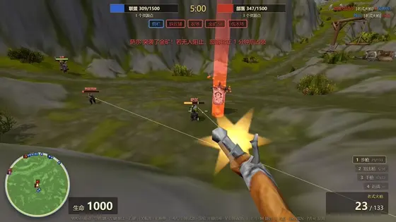
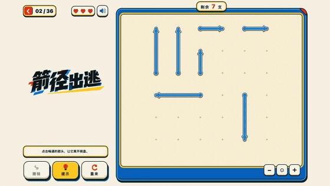
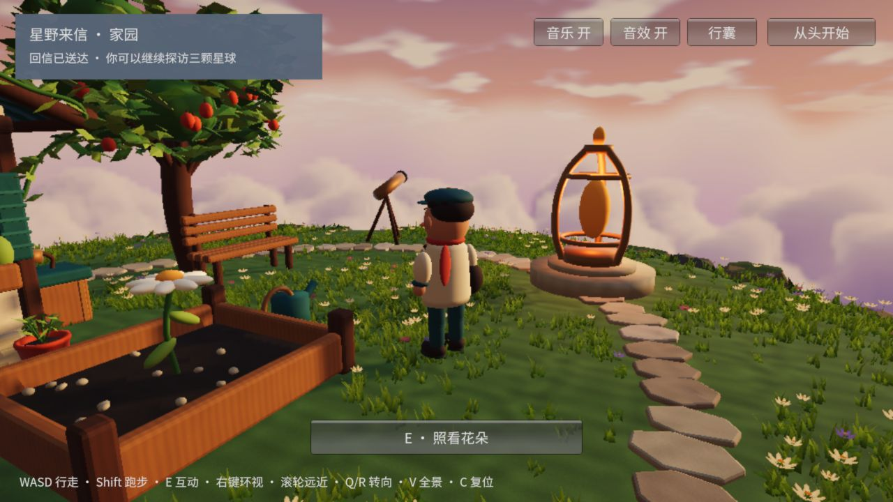
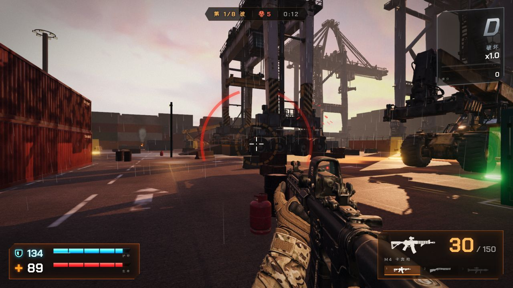
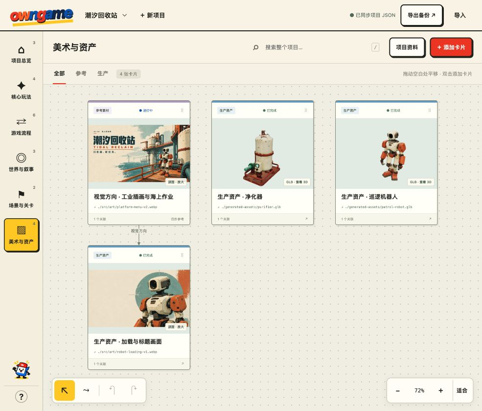

[简体中文](README.md) · English

<p align="center">
  <a href="https://owngame.dev/?lang=en"></a>
</p>

# owngame

An open-source game library and toolkit for making games with AI. Play in your browser, explore the source, and make your own version.

[Browse games](https://owngame.dev/?lang=en) · [Quick start](#quick-start) · [Discord](https://discord.gg/X5cYjTaD)

## Gameplay previews

| Azeroth Strike | Arrow Escape |
| --- | --- |
| [](https://owngame.dev/play.html?game=azeroth-strike&lang=en) | [](https://owngame.dev/play.html?game=arrow-escape&lang=en) |
| Capture points in Arathi Basin<br>[Play](https://owngame.dev/play.html?game=azeroth-strike&lang=en) · [Source](examples/azeroth-strike/) | Clear the arrows in the right order<br>[Play](https://owngame.dev/play.html?game=arrow-escape&lang=en) · [Source](examples/arrow-escape/) |

## Games

| Genre | Play in your browser |
| --- | --- |
| Shooters | [Azeroth Strike](https://owngame.dev/play.html?game=azeroth-strike&lang=en) · [Tidal Reclaim](https://owngame.dev/play.html?game=tidal-reclaim&lang=en) · [Neon Defender](https://owngame.dev/play.html?game=neon-shooter&lang=en) |
| Adventure & action | [Star Letters](https://owngame.dev/play.html?game=star-letters&lang=en) · [Faune Dungeon](https://owngame.dev/play.html?game=faune-dungeon&lang=en) · [Midnight Beacon](https://owngame.dev/play.html?game=midnight-beacon&lang=en) |
| Arcade & racing | [Crowd Rush](https://owngame.dev/play.html?game=crowd-runner&lang=en) · [Silk Serpent](https://owngame.dev/play.html?game=silk-serpent&lang=en) · [Bamboo Rally](https://owngame.dev/play.html?game=bamboo-rally&lang=en) · [RC Rally](https://owngame.dev/play.html?game=rc-rally&lang=en) |
| Puzzles & memory | [Arrow Escape](https://owngame.dev/play.html?game=arrow-escape&lang=en) · [Signal Harbor](https://owngame.dev/play.html?game=signal-harbor&lang=en) · [Nuts & Bolts](https://owngame.dev/play.html?game=unlock-bolts-mobile&lang=en) · [Postcards from the Hills](https://owngame.dev/play.html?game=postcard-slide&lang=en) · [Wind Chime Memory](https://owngame.dev/play.html?game=wind-chime-memory&lang=en) · [Petal Memory](https://owngame.dev/play.html?game=petal-memory&lang=en) · [Kiln Merge](https://owngame.dev/play.html?game=kiln-merge&lang=en) |
| Board & simulation | [Star Triad](https://owngame.dev/play.html?game=star-triad&lang=en) · [Firefly Four](https://owngame.dev/play.html?game=firefly-four&lang=en) · [Moss Reversi](https://owngame.dev/play.html?game=moss-reversi&lang=en) · [Civ Clicker](https://owngame.dev/play.html?game=civ-clicker&lang=en) |

[Game source index](examples/README.md) · [Download for Android](https://github.com/luka2chat/owngame/releases) · [iOS testing](apps/ios/README.md)

<details>
<summary>More gameplay screenshots</summary>

| [Star Letters](https://owngame.dev/play.html?game=star-letters&lang=en) | Riftstrike (local development build) |
| --- | --- |
| [](https://owngame.dev/play.html?game=star-letters&lang=en) |  |

</details>

## Quick start

Send this to an AI coding assistant that can edit project files and run commands:

```text
Follow https://raw.githubusercontent.com/luka2chat/owngame/main/docs/agent-setup.md
to set up owngame in this project, verify the installation, and help me make a game.
```

To adapt an existing game, select **Remix** on its game page and give your assistant the brief with the rules, design references, and source link.

[First game tutorial](docs/quickstart.md) · [CLI and MCP setup](docs/install.md) · [Remix guide](docs/remix.md)

## Documentation

[Docs index](docs/README.md) · [Asset search](docs/resource-search.md) · [Mobile debugging](docs/device-development.md) · [Publishing games](docs/game-publishing.md) · [Contributing](CONTRIBUTING.md)

[Templates and requirements](docs/install.md) · [Unity Home starter](templates/unity-home/README.md)

<details>
<summary>Game design board</summary>

Organize mechanics, levels, and assets with connected cards. The board and CLI/MCP read and write the same `game-outline.json` file.

[](apps/outline/README.md)

[Board guide](apps/outline/README.md) · [Level screenshot](docs/images/owngame-outline-levels.jpg) · [3D model preview](docs/images/owngame-outline-model-preview.jpg)

</details>

## Usage and licensing

Commercial use and redistribution follow each game's and asset's license. The root MIT license covers the toolkit.

- Gameplay mechanics can inspire original work. Permission to reuse the original code or assets is governed by their licenses.
- Check each project's `LICENSE` before modifying, reusing, or redistributing source.
- Check the relevant `THIRD_PARTY_NOTICES.md` and asset licenses for images, fonts, sounds, models, and engines.

[Game licensing](docs/open-source-games.md#licensing) · [Third-party notices](THIRD_PARTY_NOTICES.md)

## License and credits

The toolkit uses the [MIT license](LICENSE). Thanks to [REA](https://github.com/morluto/rea) for inspiration on organizing tools and examples, and [Manus](https://manus.im) for the authoring tools used in early prototypes of some PC games. The project first launched in the [Linux.do community](https://linux.do/).

<details>
<summary>Star history</summary>

<a href="https://www.star-history.com/?repos=luka2chat%2Fowngame&amp;type=date&amp;legend=top-left">
  <picture>
    <source media="(prefers-color-scheme: dark)" srcset="https://api.star-history.com/chart?repos=luka2chat/owngame&amp;type=date&amp;theme=dark&amp;legend=top-left" />
    
  </picture>
</a>

</details>
