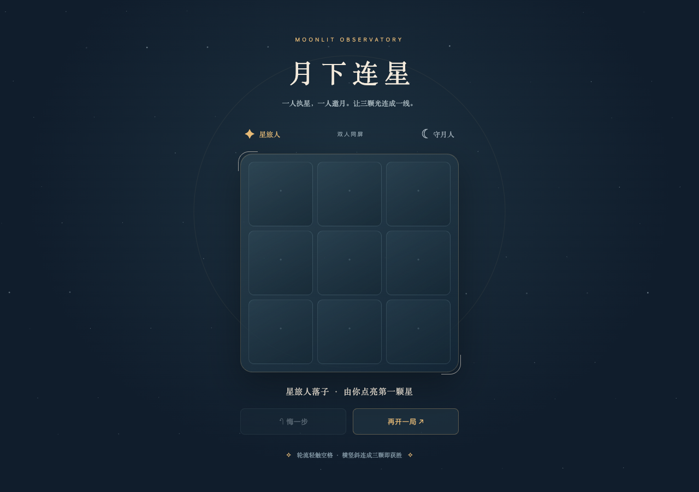

# owngame

**把游戏制作经验，变成你的 AI 助手能使用的工具。**

Art-first game authoring tools for your existing AI agent.

owngame 将真实项目中的美术、玩法和迭代经验整理成 Skill、参考案例与可运行模板。
通过 CLI 或 MCP 配合现有 AI 编程助手，制作新游戏、改进已有游戏、研究参考玩法。



## 从一个能玩的游戏开始

需要 Node.js >=22。此源码为 **0.8.0 发布候选**；公开 npm 的旧版 0.0.1 只是名称验证包，不包含本教程能力。
在正式发布前，从源码打包或使用维护者提供的 0.8.0 tarball：

```sh
npm ci
npm run build
node dist/packages/cli/index.js project.create '{"directory":"my-game","name":"my-game"}'
cd my-game
npm test
npm run build
npm run preview
```

打开 http://127.0.0.1:3215 。得到一个有原创程序绘制画面、悔棋、重开与续玩的双人小游戏，无需额外下载游戏引擎或美术资产。
修改 `src/theme.js`，重新构建、刷新，就能完成第一轮视觉修改。
[完整入门教程](docs/quickstart.md) · [安装与 Agent 接入](docs/install.md)

## 和你的 Agent 一起工作

可以这样说：

> 用 owngame 做一个夜空主题的双人小游戏，先让我看到可以玩的画面。

> 保留现有玩法和存档，把这款游戏改成手绘陶坊风格。

> 这个灯塔放四个灯时会遮住塔顶，保留美术方向，只修复这个状态。

Skill 根据任务选择流程；不是每个改动都要重新研究、做三套方案或迁移引擎。
安装包包含匹配版本的 Skill、CLI 和 stdio MCP。浏览器、图片生成、手机控制由宿主提供。

| 组成 | 当前可用 |
| --- | --- |
| 工作指引 | 新作、重设计、局部修复、参考研究；美术尽早参与判断 |
| 参考案例 | 星图三连、潮光归位、窑火相融的公开复盘与来源指纹 |
| 创建模板 | 默认可玩的 web-canvas；可选 web-phaser 与 cocos-minimal 脚手架 |
| CLI / MCP | 共用核心；知识、配方、创建、构建辅助和交付清单 |
| 安装 | setup 预览/应用项目配置，备份并检查冲突；doctor 只读诊断 |
| 验证 | 规则与安装测试、打包后 CLI/MCP 及浏览器真实输入检查 |

现阶段检索按关键词匹配，不承诺任意模糊描述的语义推荐，也不自动生成完整美术资产。
Phaser/Cocos 需要外部依赖；默认示例不需要。技术通过与用户认可美术、手感、趣味分别记录。

## 从真实制作中提炼

- [星图三连](docs/cases/star-triad.md)：从视觉比选，到真实播放器、封面和存档验证。
- [潮光归位](docs/cases/signal-harbor.md)：保留已认可风格，修复可变容量与固定美术的冲突。
- [窑火相融](docs/cases/kiln-merge.md)：区分已知参数、参考承诺和原创选择。

这些是历史经验摘要，不是工具重新执行过的实验。公开包不携带聊天记录、设备日志、原作 APK、反编译材料或生产游戏资产。
[owngame.dev](https://owngame.dev) 是成品展示与游玩入口；使用工具不要求安装玩家 App。

## 开发与贡献

```sh
npm ci
npm run test:release
npx playwright install chromium
npm run verify:package
```

[贡献指南](CONTRIBUTING.md) · [发布流程](docs/releasing.md) · [变更记录](CHANGELOG.md) · [安全边界](SECURITY.md)

工具自有代码与文档采用 [MIT](LICENSE)；第三方材料保留各自许可，见 [第三方声明](THIRD_PARTY_NOTICES.md)。
项目的安装、工具与案例组织方式参考 [REA](https://github.com/morluto/rea)。
