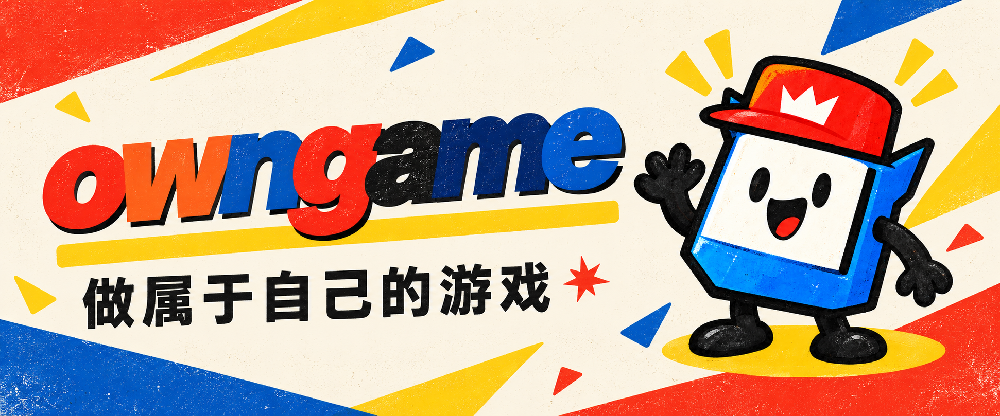
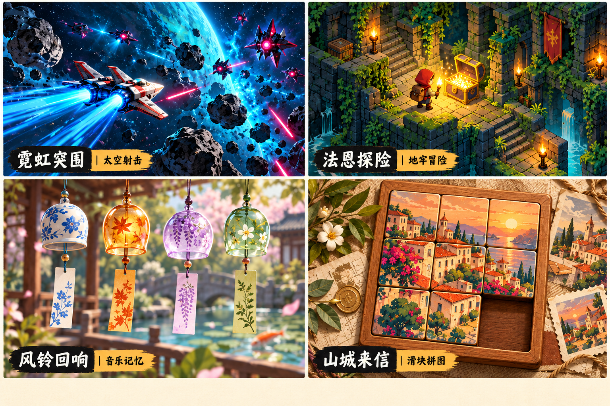
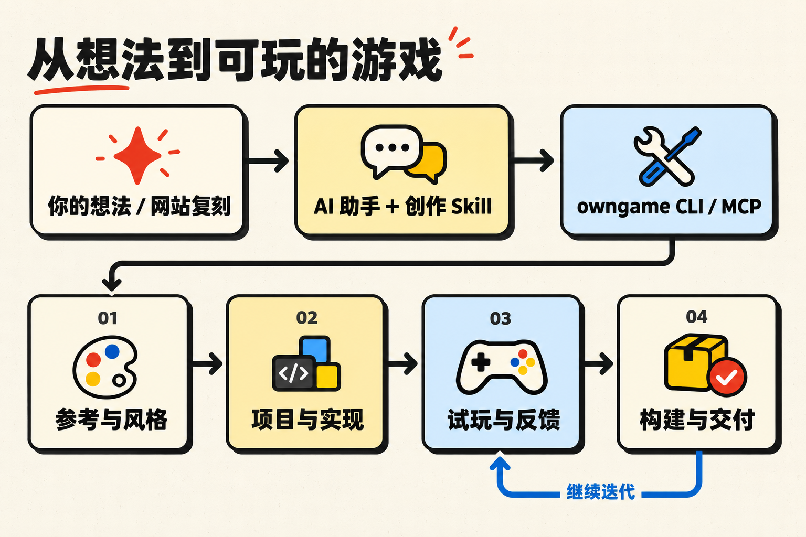

<div align="center">

<a href="https://owngame.dev"></a>

### 用 AI，把游戏做成你想要的样子。

面向 AI 助手的开源游戏创作工具包：从可玩参考出发，完成美术、玩法与交付迭代。

[](https://www.npmjs.com/package/@owngame/cli) [](package.json) [](LICENSE)

[试玩游戏](https://owngame.dev) · [快速开始](#快速开始) · [工作原理](#工作原理) · [创意案例](#创意案例) · [路线图](#支持路线图) · [文档](#文档) · [English](#english)

</div>

[](https://owngame.dev)

<p align="center"><strong>玩你喜欢的，复刻属于你的。</strong><br>射击、冒险、音乐、拼图——从一种乐趣，开始你的游戏。</p>

owngame 把参考研究、视觉设计、项目创建与交付检查，接入你已有的 AI 助手。在 [owngame.dev](https://owngame.dev) 找到喜欢的游戏，点击 **复刻**，把具体的玩法与视觉参考交给 AI，换一个主题、改一条规则，做出自己的版本。你也可以直接从一句想法开始。

## 创意案例

四款可玩的游戏，四种创作起点。点击试玩体验原作，或打开参考说明，把你的想法交给 AI。

| 游戏与类型 | 体验什么 | 可以怎样复刻 | 开始探索 |
| --- | --- | --- | --- |
| **01 · 霓虹突围**<br>太空射击 | 躲开弹幕、收集强化，迎战每三波出现的首领 | 做成深海潜航：用声呐寻找强化，在暗流中躲避机械水母 | [试玩 ↗](https://owngame.dev/play?game=neon-shooter) · [复刻参考](https://owngame.dev/remix/neon-shooter.json) |
| **02 · 法恩探险**<br>地牢冒险 | 穿过地牢，找到三只宝箱，再带着宝藏回到出发点 | 做成森林寻宝：寻找遗失的星星，沿萤火小径回到树屋 | [试玩 ↗](https://owngame.dev/play?game=faune-dungeon) · [复刻参考](https://owngame.dev/remix/faune-dungeon.json) |
| **03 · 风铃回响**<br>音乐记忆 | 听一段风铃，再敲回旋律；静音时也可跟随视觉提示 | 做成雨天音乐盒：记住雨滴落在不同杯子上的顺序 | [试玩 ↗](https://owngame.dev/play?game=wind-chime-memory) · [复刻参考](https://owngame.dev/remix/wind-chime-memory.json) |
| **04 · 山城来信**<br>滑块拼图 | 滑动纸片，拼回落日里的山城 | 做成旅行纪念册：用自己的照片拼回一段旅程 | [试玩 ↗](https://owngame.dev/play?game=postcard-slide) · [复刻参考](https://owngame.dev/remix/postcard-slide.json) |

*上方海报由 AI 绘制，用于呈现创意方向；实际画面与玩法以试玩为准。「可以怎样复刻」是创作灵感，可交给助手继续实现。*

> 试着告诉 AI：参考《风铃回响》的顺序记忆玩法，为我做一个雨天音乐盒。用不同杯子的声音和亮光提示节奏，先给我一个能玩完一轮的版本。

## 快速开始

### 1. 接入你的 AI 助手

需要 **Node.js 22 或以上**及 npm。在你的游戏项目目录中执行：

```sh
npx @owngame/cli@latest setup --agent codex --apply
```

| 助手 | 接入方式 |
| --- | --- |
| Codex | 使用 `--agent codex`，写入项目 MCP 配置与 Skill |
| Cursor | 使用 `--agent cursor`，写入项目 MCP 配置与 Skill |
| 其他支持本地 MCP 的助手 | 使用 `--agent generic`，生成配置与 Skill，再按宿主要求手动导入 |

`@latest` 获取 npm 当前发布版本。去掉 `--apply` 可预览配置变更。安装仅写入当前项目，保留其他配置，并对覆盖内容建立备份；已修改的 owngame 配置会触发冲突检查。

完成后重载助手、信任项目配置，并让助手调用 `owngame_capabilities` 确认连接。详细步骤见 [安装与接入](docs/install.md)。

### 2. 描述你想做的游戏

> 用 owngame 做一个夜空主题的双人小游戏。先实现可以玩完一局的核心玩法，把美术放进实际运行画面，再检查胜负、悔棋、重开和刷新后的续玩。

也可以打开 [owngame.dev](https://owngame.dev)，选择喜欢的游戏，点击 **复刻**，补充修改方向后将生成的任务交给助手：

> 参考《霓虹突围》，做一个深海潜航游戏。保留移动、躲避和逐波挑战，把飞船换成潜艇，敌人换成机械水母。先给我一个可玩的版本，再一起调整规则和难度。

### 3. 或者直接使用命令行

无需先配置助手，即可从默认 Web 模板创建游戏：

```sh
npx @owngame/cli@latest project.create '{"directory":"my-game","name":"my-game"}'
cd my-game
npm test
npm run build
npm run preview
```

打开 <http://127.0.0.1:3215>，即可试玩「月下连星」。默认模板不需要额外安装游戏运行依赖，包含双人同屏规则、悔棋、重开和本地续玩。完整教程见 [做出并修改第一个游戏](docs/quickstart.md)。

## 工作原理



Skill 帮助助手根据任务选择合适的步骤：新游戏从可玩核心开始，美术调整保留规则与存档，局部修复聚焦具体问题。CLI 与 MCP 共享同一套核心能力，既可用于对话式创作，也可用于命令行工作流。

owngame 提供参考、模板和检查接口；规划、代码实现、图片生成及浏览器操作由助手和它可用的工具完成。试玩结果、测试覆盖与尚未验证的部分，应随每次交付一起说明。

## 核心能力

| 能力 | 提供的内容 | 入口 |
| --- | --- | --- |
| 创作指导 | 美术、Web、Cocos、测试与迭代的任务指导 | `guidance.get` / [Skill](skills/owngame/SKILL.md) |
| 参考研究 | 检索公开案例摘要，整理任务相关的研究材料 | `research.prepare` / `knowledge.search` |
| 风格配方 | 查询视觉方向，为实际游戏画面提供设计依据 | `style.list` / `style.get` |
| 项目创建 | 创建独立游戏目录，选择 Web、Phaser 或 Cocos 起点 | `project.create` |
| 构建检查 | 检查 Web 产物并生成内容指纹；调用外部 Cocos 构建 | `web.inspect` / `cocos.build` |
| 交付记录 | 登记交付版本，记录与查询评估结果 | `delivery.register` / `assessment.record` |

当前 CLI / MCP 共享 **20 个操作**。运行以下命令查看本版本提供的能力：

```sh
npx @owngame/cli@latest capabilities
```

### 模板与运行环境

| 模板 | 初始内容 | 环境要求 |
| --- | --- | --- |
| `web-canvas`（默认） | 可玩的「月下连星」双人小游戏 | Node.js 22+ 与现代浏览器 |
| `web-phaser` | Phaser 项目脚手架，需继续实现规则、美术和内容 | 创建后安装项目依赖 |
| `cocos-minimal` | Cocos 项目脚手架，需继续实现游戏 | 单独安装 Cocos Creator 3.8.8 |

Cocos 构建适配器目前只在特定 macOS 环境验证过；浏览器、图片生成和发布能力取决于所用助手与本机环境。详见 [安装说明](docs/install.md)。

## 支持路线图

owngame 将从 Web 小游戏逐步扩展到更多引擎与发布平台，让同一套创作方法服务于 2D、3D 和跨平台游戏。下面区分当前能力、计划与调研方向；尚未提供的适配器和发布流程不包含在现有安装包中，也暂不承诺发布日期。

### 游戏引擎与创作框架

| 方向 | 状态 | 下一步 |
| --- | --- | --- |
| **Web / Phaser** | 已提供可玩 Web 起点与 Phaser 脚手架 | 丰富玩法模板、触屏适配与可复用案例，完善离线交付指导 |
| **Cocos Creator** | 已提供脚手架与有限环境验证的构建适配器 | 扩大环境覆盖，补充场景、资源与构建诊断流程 |
| **Unity** | **优先计划**；已有内部 3D 项目实践 | 整理可公开复用的 2D / 3D 起点，接入场景与资源操作、编辑器反馈和构建检查；先完成一条可验证的创作与交付流程 |
| **Three.js** | 计划中；已有本地教学原型 | 提供轻量 Web 3D 起点，整理角色、镜头、交互和加载优化的创作指导 |
| **Godot** | 计划中 | 探索项目模板、场景与脚本迭代、资源导入及导出检查 |
| **Unreal Engine** | 调研中 | 评估编辑器接入、蓝图与代码协作、资源管理和打包成本，再确定适配范围 |

Unity 的首个目标是将已有项目经验整理成可安装、可复用的工具能力。现阶段 `project.create` 仍只提供上表前两项对应的三种模板，尚不能直接创建 Unity、Three.js、Godot 或 Unreal 项目。

### 游玩与发布平台

| 平台 | 状态 | 计划覆盖 |
| --- | --- | --- |
| **浏览器 / Web** | 当前主要交付平台 | 持续完善电脑与手机浏览器体验、静态托管和离线验证 |
| **Android** | 已有内部 Alpha 客户端，尚未公开分发 | 完善游戏下载、更新与离线体验，整理正式签名、安装和版本发布流程 |
| **iOS / iPadOS** | 计划中 | 评估原生容器与引擎导出方案，补充触控、安全区、存档和真机验收流程 |
| **Windows / macOS / Linux** | 原生桌面发布计划中 | 探索独立安装包、输入适配、存档位置与分发流程；当前可通过浏览器游玩 Web 游戏 |
| **微信等小游戏平台** | 调研中 | 评估运行环境、包体与资源限制、平台接口及审核要求，确定适合接入的游戏类型 |

推进顺序以 **Unity 创作流程 → 更多引擎模板 → 更广的平台交付** 为主，并根据实际游戏需求调整。每项支持会明确标注可用模板、运行环境和验证范围；引擎能导出某个平台，并不代表 owngame 已完成该平台的适配。

欢迎在 [Issues](https://github.com/luka2chat/owngame/issues) 提交你希望支持的引擎、目标平台和具体游戏需求，或通过 [贡献指南](CONTRIBUTING.md) 参与适配。

## 常见问题

<details>
<summary><strong>复刻会提供什么？</strong></summary>

复刻生成一段可交给 AI 的创作任务，包含游戏链接、玩法、视觉方向、公开参考说明与工具接入信息。助手据此在你的工作区实现新版本。它不在网站后台生成游戏，也不直接导出网站游戏源码。详见 [复刻使用说明](https://github.com/luka2chat/owngame/blob/main/docs/remix.md)。

</details>

<details>
<summary><strong>必须使用 AI 助手吗？</strong></summary>

不必须。CLI 可以独立创建项目、查询参考并检查构建产物。使用助手时，Skill 提供创作指导，MCP 提供工具调用接口；只安装 Skill 不会自动安装 MCP、浏览器或游戏引擎。

</details>

<details>
<summary><strong>生成的游戏可以离线玩吗？</strong></summary>

离线能力需要按最终交付方式验证。默认 Web 模板无需外部字体、图片或 CDN，但不包含 Service Worker，也不保证关闭本地服务器后仍能离线冷启动。实际项目若需要离线使用，应加入相应缓存或打包方案，并验证断网启动与存档恢复。

</details>

<details>
<summary><strong>参考研究会自动搜索互联网吗？</strong></summary>

当前内置研究基于关键词匹配，公开包包含三个历史案例摘要。网站游戏另有各自的复刻参考说明。扩大研究范围需要助手自己的检索能力，或接入符合格式的自有案例库。

</details>

## 文档

- [安装与 Agent 接入](docs/install.md)：配置、连接检查、更新与卸载。
- [第一个游戏](docs/quickstart.md)：创建、试玩、修改美术与验证存档。
- [复刻使用说明](https://github.com/luka2chat/owngame/blob/main/docs/remix.md)：从网站参考进入自己的工作区。
- [历史制作复盘](docs/cases/)：星图三连、潮光归位与窑火相融的实践记录。
- [创作 Skill](skills/owngame/SKILL.md) 与 [风格配方](docs/style-recipes.json)：工作流程和视觉方向。
- [贡献指南](CONTRIBUTING.md)、[发布流程](docs/releasing.md) 与 [变更记录](CHANGELOG.md)。
- [安全说明](SECURITY.md) 与 [第三方声明](THIRD_PARTY_NOTICES.md)。

## 参与贡献

欢迎贡献可复现的问题修复、可移植的游戏模板、制作案例与风格配方。提交问题时，请附上工具版本、复现步骤、预期行为和实际结果。

本地开发从以下命令开始：

```sh
git clone https://github.com/luka2chat/owngame.git
cd owngame
npm ci
npm run test:release
```

完整的安装包验证使用 `npm run verify:package`，覆盖独立安装、CLI / MCP 调用、游戏构建及浏览器真实输入。浏览器依赖与运行要求见 [贡献指南](CONTRIBUTING.md)。

[报告问题](https://github.com/luka2chat/owngame/issues) · [提交改进](https://github.com/luka2chat/owngame/pulls)

## 许可与致谢

owngame 自有代码与文档采用 [MIT 许可](LICENSE)。网站展示游戏、素材和其他第三方内容保留各自许可，详见 [第三方声明](THIRD_PARTY_NOTICES.md)。

项目的安装体验、工具与案例组织方式参考了 [REA](https://github.com/morluto/rea)。

## English

**Make games your own, with your AI agent.**

owngame is an open-source game authoring toolkit that connects your existing AI assistant to practical workflows, playable Web starters, visual style recipes, and lessons from real game projects. Its CLI and MCP interfaces share the same core operations.

Start with an idea, or play a game on [owngame.dev](https://owngame.dev) and use **Recreate (复刻)** to bring its rules and visual direction into your own workspace. Your agent implements and tests the new version with you; the Recreate action provides a creative brief and references, rather than exporting the website game's source code.

Requires **Node.js 22+** and npm. Run the setup command in the quick start section in your game project, reload your assistant, and verify the connection. Codex and Cursor have project setup options; other local MCP clients can use the generic configuration. The default Web starter is playable immediately, while Phaser and Cocos templates provide scaffolding for further development.

**Roadmap:** Unity integration is the next priority, followed by additional engine templates and platform delivery workflows. Three.js and Godot are planned; Unreal Engine and mini-game platforms are under evaluation. Native desktop and iOS delivery are planned, while the Android client remains an internal alpha. See the [support roadmap](#支持路线图) for scope and status.

[Get started](#快速开始) · [Installation](docs/install.md) · [First game tutorial](docs/quickstart.md) · [Contributing](CONTRIBUTING.md)
