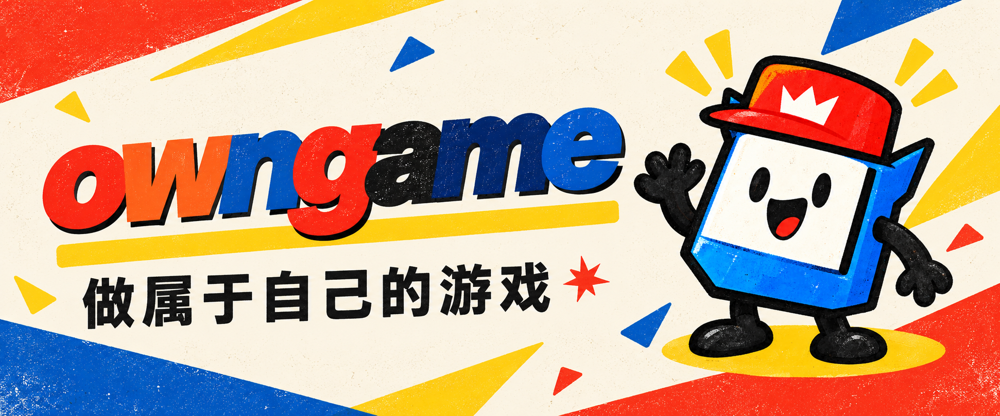
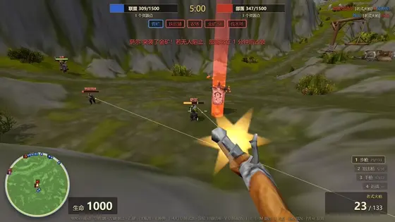
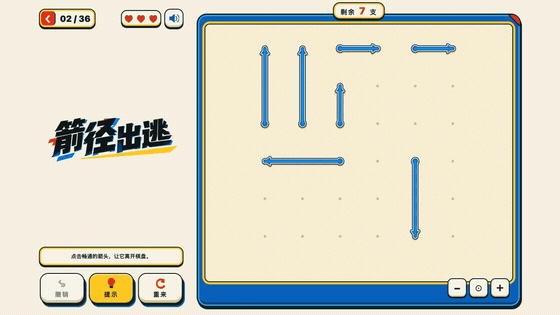
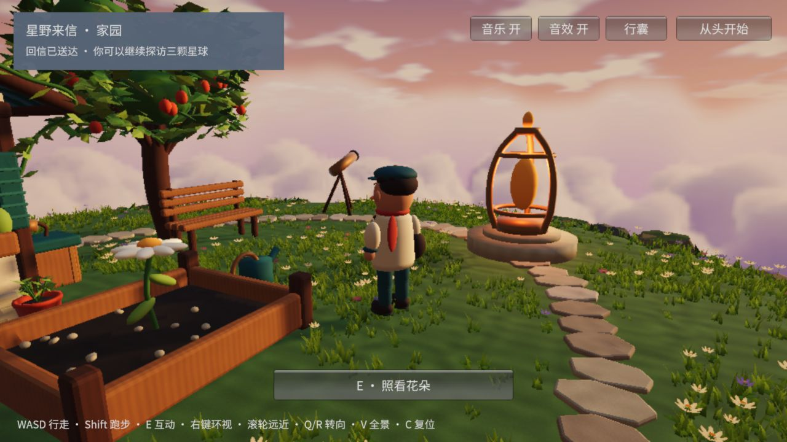
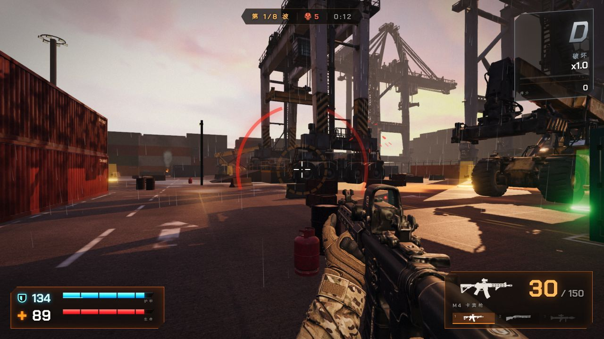
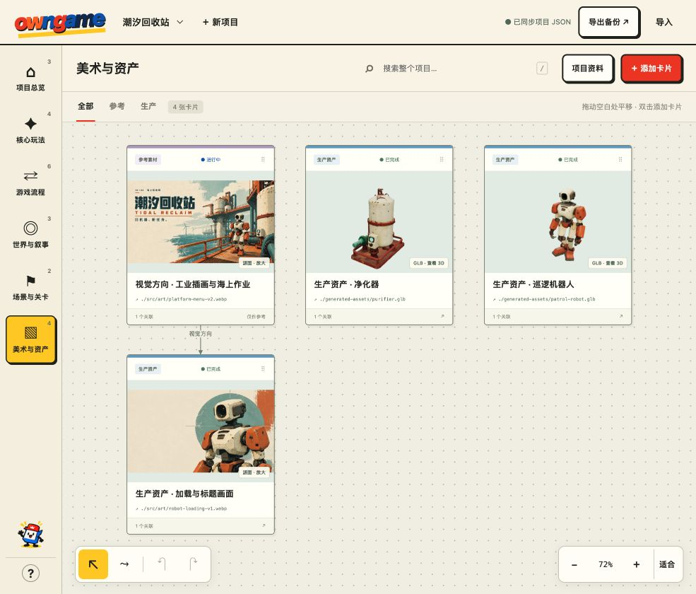

简体中文 · [English](README.en.md)

<p align="center">
  <a href="https://owngame.dev"></a>
</p>

# owngame

开源游戏库与 AI 游戏创作工具。打开就能玩，也可以看源码、做自己的版本。

[在线游戏库](https://owngame.dev) · [快速开始](#快速开始) · [Discord](https://discord.gg/X5cYjTaD)

## 实机演示

| 艾泽拉斯反恐精英 | 箭径出逃 |
| --- | --- |
| [](https://owngame.dev/play.html?game=azeroth-strike) | [](https://owngame.dev/play.html?game=arrow-escape) |
| 阿拉希盆地占点<br>[试玩](https://owngame.dev/play.html?game=azeroth-strike) · [源码](examples/azeroth-strike/) | 按顺序移出棋盘上的箭头<br>[试玩](https://owngame.dev/play.html?game=arrow-escape) · [源码](examples/arrow-escape/) |

## 游戏列表

| 类型 | 点击试玩 |
| --- | --- |
| 射击 | [艾泽拉斯反恐精英](https://owngame.dev/play.html?game=azeroth-strike) · [潮汐回收站](https://owngame.dev/play.html?game=tidal-reclaim) · [霓虹突围](https://owngame.dev/play.html?game=neon-shooter) |
| 冒险与动作 | [星野来信](https://owngame.dev/play.html?game=star-letters) · [法恩探险](https://owngame.dev/play.html?game=faune-dungeon) · [午夜灯塔](https://owngame.dev/play.html?game=midnight-beacon) |
| 街机与竞速 | [人潮冲线](https://owngame.dev/play.html?game=crowd-runner) · [绢龙逐珠](https://owngame.dev/play.html?game=silk-serpent) · [竹影回珠](https://owngame.dev/play.html?game=bamboo-rally) · [遥控冲线](https://owngame.dev/play.html?game=rc-rally) |
| 解谜与记忆 | [箭径出逃](https://owngame.dev/play.html?game=arrow-escape) · [潮光归位](https://owngame.dev/play.html?game=signal-harbor) · [螺帽之间](https://owngame.dev/play.html?game=unlock-bolts-mobile) · [山城来信](https://owngame.dev/play.html?game=postcard-slide) · [风铃回响](https://owngame.dev/play.html?game=wind-chime-memory) · [花笺拾忆](https://owngame.dev/play.html?game=petal-memory) · [窑火相融](https://owngame.dev/play.html?game=kiln-merge) |
| 棋盘与模拟 | [星图三连](https://owngame.dev/play.html?game=star-triad) · [萤灯四连](https://owngame.dev/play.html?game=firefly-four) · [苔庭翻面](https://owngame.dev/play.html?game=moss-reversi) · [小小文明](https://owngame.dev/play.html?game=civ-clicker) |

[完整源码清单](examples/README.md) · [Android 下载](https://github.com/luka2chat/owngame/releases) · [iOS 测试](apps/ios/README.md)

<details>
<summary>更多实机截图</summary>

| [星野来信](https://owngame.dev/play.html?game=star-letters) | 裂隙突击（本地开发版） |
| --- | --- |
| [](https://owngame.dev/play.html?game=star-letters) |  |

</details>

<a id="开始创作"></a>

## 快速开始

把这段话发给能读写项目、运行命令的 AI 编程助手：

```text
请按 https://raw.githubusercontent.com/luka2chat/owngame/main/docs/agent-setup.md 接入 owngame，
验证安装后，帮我做一个游戏。
```

想改现有游戏？在游戏页点 **复刻**，把包含玩法、设计参考和源码链接的创作任务交给助手。

[中文入门](docs/zh-CN/quickstart.md) · [CLI 与 MCP 安装](docs/install.md) · [复刻说明](docs/remix.md)

<a id="工具与模板"></a>
<a id="模板与运行环境"></a>
<a id="支持路线图"></a>

## 文档

[文档索引](docs/README.md) · [素材搜索](docs/resource-search.md) · [手机调试](docs/device-development.md) · [发布游戏](docs/game-publishing.md) · [贡献指南](CONTRIBUTING.md)

[模板与运行环境](docs/install.md) · [Unity 家园模板](templates/unity-home/README.md)

<details>
<summary>游戏设计画板</summary>

用卡片和连线整理玩法、关卡和素材。画板与 CLI / MCP 共用项目里的 `game-outline.json`。

[](apps/outline/README.md)

[使用画板](apps/outline/README.md) · [关卡截图](docs/images/owngame-outline-levels.jpg) · [3D 模型预览](docs/images/owngame-outline-model-preview.jpg)

</details>

## 使用与授权

**商用和再分发按具体项目及素材许可执行，根目录 MIT 不替代这些许可。**

- **玩法参考**：可以从游戏的玩法与体验出发创作；参考玩法本身不构成原作代码或素材的复用授权。
- **源码复用**：先查看具体项目的 `LICENSE`；商用、修改或再分发时，遵守相应许可证的要求，包括适用的版权声明、许可保留和源码提供义务。
- **素材复用**：图片、字体、音效、模型和引擎可能单独授权。复用前查看对应目录的 `THIRD_PARTY_NOTICES.md` 及素材许可，遵守署名、许可保留和使用范围等条件。

查看[游戏源码授权说明](docs/open-source-games.md#授权)与[第三方声明](THIRD_PARTY_NOTICES.md)。

## 许可与致谢

工具包使用 [MIT 许可](LICENSE)。感谢 [REA](https://github.com/morluto/rea) 提供工具和案例组织参考，以及 [Manus](https://manus.im) 为部分 PC 游戏的早期原型提供创作工具。项目首发于 [Linux.do 社区](https://linux.do/)。

<details>
<summary>Star history</summary>

<a href="https://www.star-history.com/?repos=luka2chat%2Fowngame&amp;type=date&amp;legend=top-left">
  <picture>
    <source media="(prefers-color-scheme: dark)" srcset="https://api.star-history.com/chart?repos=luka2chat/owngame&amp;type=date&amp;theme=dark&amp;legend=top-left" />
    
  </picture>
</a>

</details>
