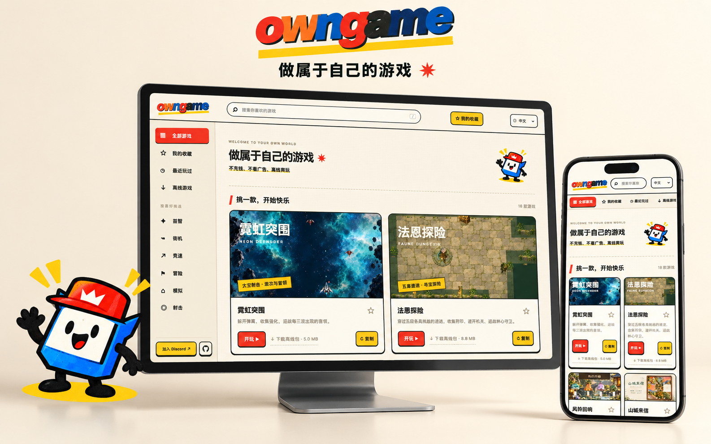
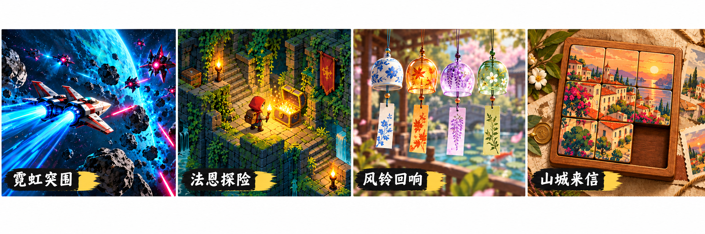
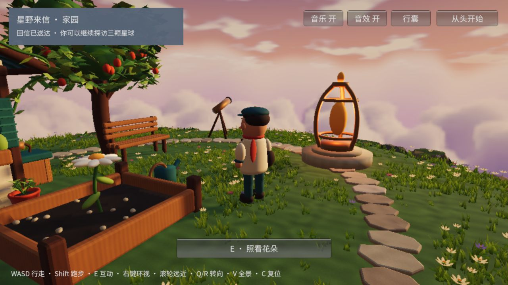

<div align="center">

<a href="https://owngame.dev"></a>

# 用 AI，把游戏做成你想要的样子

面向 AI 助手的开源游戏创作工具包。

[](https://www.npmjs.com/package/@owngame/cli) [](package.json) [](LICENSE) [](https://discord.gg/X5cYjTaD)

[**试玩游戏 ↗**](https://owngame.dev) · [**快速开始**](#开始创作) · [文档](#文档) · [Discord](https://discord.gg/X5cYjTaD)

</div>

<a id="平台一览"></a>

## 在电脑与手机上，随时开玩

浏览游戏、收藏喜欢的作品，在下载完成后离线游玩。想继续创作时，点击 **复刻**，把参考说明与源码链接交给 AI 助手。

[](https://owngame.dev)

按 **移动端 / PC** 选游戏，支持设备见游戏标识；手机 App 仅收录移动端作品。

[**打开游戏库 ↗**](https://owngame.dev) · [查看游戏源码](docs/open-source-games.md)

<a id="快速开始"></a>

## 开始创作

在游戏项目中打开 AI 编程助手，把下面这句话发给它：

```text
请按照以下说明，在当前项目接入 owngame，完成安装和可用性检查，然后帮我做游戏：
https://raw.githubusercontent.com/luka2chat/owngame/main/docs/agent-setup.md
如果我还没说明想做什么游戏，请先给几个方向让我选择，等我选定后再开始制作。
```

描述想法 → 试玩反馈 → 继续打磨。无需选择助手类型或配置 MCP。

<details>
<summary>接入说明、创作示例与命令行用法</summary>

助手会按[接入说明](docs/agent-setup.md)检查环境、安装当前发布版本并验证可用性；需要能读写项目并执行命令的助手。

描述你想做的游戏，或在[游戏库](https://owngame.dev)点击 **复刻**，把参考说明与自己的修改方向一起交给助手：

> 用 owngame 做一个夜空主题的双人小游戏。先完成可玩的一局，再一起调整美术、规则和难度，并验证存档与重开。

也可以直接使用命令行：

```sh
npx @owngame/cli@latest project.create '{"directory":"my-game","name":"my-game"}'
cd my-game
npm test
npm run build
npm run preview
```

按终端提示打开预览地址。[完整教程](docs/quickstart.md) · [安装与可选 MCP 配置](docs/install.md)

</details>

## 你可以用 owngame 做什么

| 💡 找灵感 | 🎮 做游戏 | ✅ 验证交付 |
| --- | --- | --- |
| 从可玩的作品、案例与风格配方中找到方向 | 在现有 AI 助手里创建项目、调整玩法与美术 | 检查构建、记录反馈，验证试玩与存档 |

owngame 提供参考、模板和检查接口；代码实现、图片生成及浏览器操作由助手和它可用的工具完成。

<a id="创意案例"></a>

## 从可玩的作品出发

[](https://owngame.dev)

[太空射击 ↗](https://owngame.dev/play?game=neon-shooter) · [地牢冒险 ↗](https://owngame.dev/play?game=faune-dungeon) · [音乐记忆 ↗](https://owngame.dev/play?game=wind-chime-memory) · [滑块拼图 ↗](https://owngame.dev/play?game=postcard-slide)

*AI 创意海报；实际画面与玩法以试玩为准。*

<details>
<summary><strong>查看案例玩法与复刻灵感</strong></summary>

从不同玩法与视觉风格出发，探索游戏创作的可能性。点击试玩体验原作，或打开参考说明，把你的想法交给 AI。

| 游戏与类型 | 体验什么 | 可以怎样复刻 | 开始探索 |
| --- | --- | --- | --- |
| **01 · 霓虹突围**<br>太空射击 | 躲开弹幕、收集强化，迎战首领 | 做成深海潜航：用声呐寻找强化，在暗流中躲避机械水母 | [试玩 ↗](https://owngame.dev/play?game=neon-shooter) · [复刻参考](https://owngame.dev/remix/neon-shooter.json) |
| **02 · 法恩探险**<br>地牢冒险 | 穿过地牢，寻找宝箱，再带着宝藏回到出发点 | 做成森林寻宝：寻找遗失的星星，沿萤火小径回到树屋 | [试玩 ↗](https://owngame.dev/play?game=faune-dungeon) · [复刻参考](https://owngame.dev/remix/faune-dungeon.json) |
| **03 · 风铃回响**<br>音乐记忆 | 听一段风铃，再敲回旋律；静音时也可跟随视觉提示 | 做成雨天音乐盒：记住雨滴落在不同杯子上的顺序 | [试玩 ↗](https://owngame.dev/play?game=wind-chime-memory) · [复刻参考](https://owngame.dev/remix/wind-chime-memory.json) |
| **04 · 山城来信**<br>滑块拼图 | 滑动纸片，拼回落日里的山城 | 做成旅行纪念册：用自己的照片拼回一段旅程 | [试玩 ↗](https://owngame.dev/play?game=postcard-slide) · [复刻参考](https://owngame.dev/remix/postcard-slide.json) |

*案例海报由 AI 绘制，用于呈现创意方向；实际画面与玩法以试玩为准。「可以怎样复刻」是创作灵感，可交给助手继续实现。*

> 试着告诉 AI：参考《风铃回响》的顺序记忆玩法，为我做一个雨天音乐盒。用不同杯子的声音和亮光提示节奏，先给我一个能玩完一轮的版本。

</details>

<a id="3d-推荐"></a>

<details>
<summary><strong>探索 3D 游戏案例</strong></summary>

### 星野来信 · 迟到的春天

**把一封信，送到春天里。** 一款可以在浏览器试玩的 3D 童话冒险：从云海上的小小家园出发，拜访邻星的朋友，最后为巨人的花园带来春天。

[](https://owngame.dev/play?game=star-letters)

[**在线试玩 ↗**](https://owngame.dev/play?game=star-letters) · [案例页面](https://owngame.dev/cases/star-letters/) · [制作笔记](docs/cases/star-letters.md) · [完整案例源码](examples/star-letters/)

- **玩一段温柔的冒险**：收信、照看花朵、调整风向与灌溉，把邀请送到朋友手中。剧情支持自动保存、回访和结局后的继续旅行。
- **看看 3D 世界怎样做出来**：Unity 故事版公开场景、角色与环境资源、生成脚本，展示故事进度、角色交互、镜头避障和冬春变化怎样配合。
- **从一个小实验开始**：附带独立的 Three.js 教学原型，可研究球面行走、程序化角色与镜头，再尝试自己的小星球主题。

> 试着告诉 AI：参考《星野来信》，做一座漂浮在云海上的邮局小岛。先实现行走、环视和投递一封信，再为岛上的居民补充故事。

*配图为游戏实拍。操作方式、加载要求与设备适配情况见[案例页面](https://owngame.dev/cases/star-letters/)。*

原创代码、对白与程序化素材采用 MIT；字体、Unity 衍生配置与运行时分别遵循其许可，详见[授权说明](examples/star-letters/THIRD_PARTY_NOTICES.md)。这个案例可独立阅读和修改；家园场景另已提取为 [`unity-home` 模板](templates/unity-home)。通用 Unity 构建适配与 Three.js 项目创建仍在计划中。

</details>

<a id="工作原理"></a>

<details>
<summary><strong>查看工作原理</strong></summary>


Skill 帮助助手根据任务选择合适的步骤：新游戏从可玩核心开始，美术调整保留规则与存档，局部修复聚焦具体问题。CLI 与 MCP 共享同一套核心能力，既可用于对话式创作，也可用于命令行工作流。

owngame 提供参考、模板和检查接口；规划、代码实现、图片生成及浏览器操作由助手和它可用的工具完成。试玩结果、测试覆盖与尚未验证的部分，应随每次交付一起说明。

</details>

## 网站游戏源码

上架游戏的可编辑源码按游戏 ID 整理在 [examples](examples/)，与对应线上版本保持一致。运行方法、项目许可与版本信息见[源码清单](docs/open-source-games.md)及 [games.json](games.json)。新增或更新游戏遵循[源码与网站联合发布流程](docs/game-publishing.md)。

<a id="核心能力"></a>

## 工具与模板

<details>
<summary><strong>查看核心能力、模板与运行环境</strong></summary>

| 能力 | 提供的内容 | 入口 |
| --- | --- | --- |
| 创作指导 | 美术、Web、Cocos、测试与迭代的任务指导 | `guidance.get` / [Skill](skills/owngame/SKILL.md) |
| 参考研究 | 检索公开案例摘要，整理任务相关的研究材料 | `research.prepare` / `knowledge.search` |
| 游戏设计画板（0.11.2） | 本地无限画布与每个游戏的设计 JSON 共用，供助手持续读取和回写 | `outline [游戏目录]` / `outline.get` / [使用说明](apps/outline/README.md) |
| 素材搜索（0.10.0） | 实时搜索模型、PBR 贴图、HDRI、图片参考，返回预览、来源许可与文件依赖 | `resource.search` / `resource.get` / [使用说明](docs/resource-search.md) |
| 风格配方 | 查询视觉方向，为实际游戏画面提供设计依据 | `style.list` / `style.get` |
| 项目创建 | 创建独立游戏目录，选择 Web、Phaser、Cocos 或 Unity 起点 | `project.create` |
| 构建检查 | 检查 Web 产物并生成内容指纹；调用外部 Cocos 构建 | `web.inspect` / `cocos.build` |
| 交付记录 | 登记交付版本，记录与查询评估结果 | `delivery.register` / `assessment.record` |

CLI 与 MCP 共享核心能力。运行以下命令查看所用版本提供的操作：

```sh
npx @owngame/cli@latest capabilities
```

### 模板与运行环境

| 模板 | 初始内容 | 环境要求 |
| --- | --- | --- |
| `web-canvas`（默认） | 可直接试玩的 Web 游戏起点 | Node.js 与现代浏览器，详见[安装要求](docs/install.md) |
| `web-phaser` | Phaser 项目脚手架，需继续实现规则、美术和内容 | 创建后安装项目依赖 |
| `cocos-minimal` | Cocos 项目脚手架，需继续实现游戏 | 单独安装 Cocos Creator，版本要求见[安装说明](docs/install.md) |
| [`unity-home`](templates/unity-home) | 家园探索：角色移动、镜头与互动任务 | 单独安装 Unity，编辑器与渲染管线要求见[模板说明](templates/unity-home/README.md) |

创建 Unity 游戏（无需先克隆仓库）：

```sh
npx @owngame/cli@latest project.create '{"directory":"my-unity-game","name":"my-unity-game","template":"unity-home"}'
```

在 Unity Hub 中添加生成的目录，打开 `Assets/Scenes/HomeArt.unity` 并点击 Play。所需环境见[安装说明](docs/install.md)与[Unity 模板说明](templates/unity-home/README.md)；首次使用会安装工具包与 Unity 项目依赖。

Cocos 构建适配器目前只在特定 macOS 环境验证过；浏览器、图片生成和发布能力取决于所用助手与本机环境。详见 [安装说明](docs/install.md)。

</details>

## 支持路线图

Web 是当前主要交付平台；引擎与平台适配按实际项目需求推进。

<details>
<summary><strong>查看已提供、计划与调研中的支持</strong></summary>

owngame 将从 Web 小游戏逐步扩展到更多引擎与发布平台，让同一套创作方法服务于 2D、3D 和跨平台游戏。下面区分当前能力、计划与调研方向；尚未提供的适配器和发布流程不包含在现有安装包中，也暂不承诺发布日期。

### 游戏引擎与创作框架

| 方向 | 状态 | 下一步 |
| --- | --- | --- |
| **Web / Phaser** | 已提供可玩 Web 起点与 Phaser 脚手架 | 丰富玩法模板、触屏适配与可复用案例，完善离线交付指导 |
| **Cocos Creator** | 已提供脚手架与有限环境验证的构建适配器 | 扩大环境覆盖，补充场景、资源与构建诊断流程 |
| **Unity** | 已提供 `unity-home` 单场景 3D 模板（CLI / MCP）与完整游戏案例 | 逐步接入编辑器反馈、场景与资源操作及构建检查 |
| **Three.js** | 计划中；已公开独立教学原型 | 提供轻量 Web 3D 起点，整理角色、镜头、交互和加载优化的创作指导 |
| **Godot** | 计划中 | 探索项目模板、场景与脚本迭代、资源导入及导出检查 |
| **Unreal Engine** | 调研中 | 评估编辑器接入、蓝图与代码协作、资源管理和打包成本，再确定适配范围 |

已提供的模板通过同一 CLI / MCP 入口创建；Unity 起点的[打开与创建方法](templates/unity-home/README.md)见模板说明。Unity 编辑器与目标平台模块需单独安装，通用 Unity 构建适配器仍在计划中。Three.js、Godot 与 Unreal 项目创建尚未提供。

### 游玩与发布平台

| 平台 | 状态 | 计划覆盖 |
| --- | --- | --- |
| **浏览器 / Web** | 当前主要交付平台 | 持续完善电脑与手机浏览器体验、静态托管和离线验证 |
| **Android** | [源码](apps/android)与[APK 发布记录](https://github.com/luka2chat/owngame/releases) 已公开 | 完善游戏下载、更新与离线体验，整理正式签名、安装和版本发布流程 |
| **iOS / iPadOS** | 计划中 | 评估原生容器与引擎导出方案，补充触控、安全区、存档和真机验收流程 |
| **Windows / macOS / Linux** | 原生桌面发布计划中 | 探索独立安装包、输入适配、存档位置与分发流程；当前可通过浏览器游玩 Web 游戏 |
| **微信等小游戏平台** | 调研中 | 评估运行环境、包体与资源限制、平台接口及审核要求，确定适合接入的游戏类型 |

推进顺序以 **Unity 创作流程 → 更多引擎模板 → 更广的平台交付** 为主，并根据实际游戏需求调整。每项支持会明确标注可用模板、运行环境和验证范围；引擎能导出某个平台，并不代表 owngame 已完成该平台的适配。

欢迎在 [Issues](https://github.com/luka2chat/owngame/issues) 提交你希望支持的引擎、目标平台和具体游戏需求，或通过 [贡献指南](CONTRIBUTING.md) 参与适配。

</details>

## 常见问题

<details>
<summary><strong>复刻会提供什么？</strong></summary>

复刻生成一段可交给 AI 的创作任务，包含游戏链接、玩法、视觉方向、公开参考说明与工具接入信息。助手据此在你的工作区实现新版本。每款网站游戏的对应源码已在 GitHub 公开，复刻说明包含源码链接；按钮仍负责生成创作任务，完整游戏按各自许可使用。详见 [复刻使用说明](docs/remix.md)。

</details>

<details>
<summary><strong>必须使用 AI 助手吗？</strong></summary>

不必须。CLI 可以独立创建项目、查询参考并检查构建产物。使用助手时，Skill 提供创作指导，MCP 提供工具调用接口；只安装 Skill 不会自动安装 MCP、浏览器或游戏引擎。

</details>

<details>
<summary><strong>生成的游戏可以离线玩吗？</strong></summary>

离线能力需要按最终交付方式验证。默认 Web 模板无需外部字体、图片或 CDN，但不包含 Service Worker，也不保证关闭本地服务器后仍能离线冷启动。实际项目若需要离线使用，应加入相应缓存或打包方案，并验证断网启动与存档恢复。

</details>

<details>
<summary><strong>参考研究会自动搜索互联网吗？</strong></summary>

当前内置研究基于关键词匹配，公开包提供历史案例摘要，具体内容以所用版本为准。网站游戏另有各自的复刻参考说明。扩大研究范围需要助手自己的检索能力，或接入符合格式的自有案例库。

</details>

## 文档

[文档索引（English）](docs/README.md) · [中文入门](docs/zh-CN/quickstart.md)

[接入助手](docs/agent-setup.md) · [安装说明](docs/install.md) · [第一个游戏](docs/quickstart.md) · [游戏源码](docs/open-source-games.md) · [制作案例](docs/cases/) · [创作 Skill](skills/owngame/SKILL.md) · [变更记录](CHANGELOG.md)

## 参与贡献

在 [Discord](https://discord.gg/X5cYjTaD) 分享作品和试玩反馈；通过 [Issues](https://github.com/luka2chat/owngame/issues) 报告问题或提出需求。贡献代码、模板与案例前，请阅读[贡献指南](CONTRIBUTING.md)。

## 使用与授权

**商用和再分发按具体项目及素材许可执行，根目录 MIT 不替代这些许可。**

- **玩法参考**：可以从游戏的玩法与体验出发创作；参考玩法本身不构成原作代码或素材的复用授权。
- **源码复用**：先查看具体项目的 `LICENSE`；商用、修改或再分发时，遵守相应许可证的要求，包括适用的版权声明、许可保留和源码提供义务。
- **素材复用**：图片、字体、音效、模型和引擎可能单独授权。复用前查看对应目录的 `THIRD_PARTY_NOTICES.md` 及素材许可，遵守署名、许可保留和使用范围等条件。

查看[游戏源码授权说明](docs/open-source-games.md#授权)与[第三方声明](THIRD_PARTY_NOTICES.md)。

## 许可与致谢

owngame 自有代码与文档采用 [MIT 许可](LICENSE)。网站展示游戏、素材和其他第三方内容保留各自许可，详见 [第三方声明](THIRD_PARTY_NOTICES.md)。

项目的安装体验、工具与案例组织方式参考了 [REA](https://github.com/morluto/rea)。

部分 PC 游戏基于作者使用 [Manus](https://manus.im) 付费账号制作的作品进行二次开发，感谢 Manus 提供的创作工具。

项目首发于 [Linux.do 社区](https://linux.do/)。

## English

**Make games your own, with your AI agent.**

owngame is an open-source game authoring toolkit that connects your existing AI assistant to practical workflows, playable Web starters, visual style recipes, and lessons from real game projects. Its CLI and MCP interfaces share the same core operations.

Start with an idea, or play a game on [owngame.dev](https://owngame.dev) and use **Recreate (复刻)** to bring its rules and visual direction into your own workspace. Your agent implements and tests the new version with you; the Recreate action provides a creative brief and references, and links to the corresponding open-source game. Hosted games have editable sources in [examples/](examples/), with per-project licenses and version manifests. See the [source index](docs/open-source-games.md) for the current catalogue.

Open your game project in an AI coding assistant and send: **Follow https://raw.githubusercontent.com/luka2chat/owngame/main/docs/agent-setup.md to set up owngame in this project, verify it works, then help me make a game.** The assistant checks Node.js and npm against the [installation requirements](docs/install.md), installs the published toolkit, reads the creative Skill, and uses the shared CLI. No assistant selection or MCP configuration is required. This works with assistants that can read/write project files and run commands. See [manual installation and optional MCP](docs/install.md). The default Web starter is playable immediately, while Phaser and Cocos templates provide scaffolding for further development.

**Unity starter:** The repository now includes [`unity-home`](templates/unity-home), a standalone exploration scene with character controls, camera and interactive tasks. Create it through CLI/MCP: use `npx @owngame/cli@latest project.create` with `"template":"unity-home"`. Unity Editor is installed separately. **Roadmap:** Unity editor/build integration remains the next priority, followed by additional engine templates and platform delivery workflows. Three.js and Godot are planned; Unreal Engine and mini-game platforms are under evaluation. Native desktop and iOS delivery are planned, while the [Android client source](apps/android) is public and APK builds are listed in [Releases](https://github.com/luka2chat/owngame/releases). See the [support roadmap](#支持路线图) for scope and status.

[Documentation](docs/README.md) · [Get started](#快速开始) · [Discord community](https://discord.gg/X5cYjTaD) · [Installation](docs/install.md) · [First game tutorial](docs/quickstart.md) · [Contributing](CONTRIBUTING.md)

## Star history

Thanks for playing, creating, sharing feedback and contributing to owngame.

<a href="https://www.star-history.com/?repos=luka2chat%2Fowngame&amp;type=date&amp;legend=top-left">
  <picture>
    <source media="(prefers-color-scheme: dark)" srcset="https://api.star-history.com/chart?repos=luka2chat/owngame&amp;type=date&amp;theme=dark&amp;legend=top-left" />
    <source media="(prefers-color-scheme: light)" srcset="https://api.star-history.com/chart?repos=luka2chat/owngame&amp;type=date&amp;legend=top-left" />
    
  </picture>
</a>
